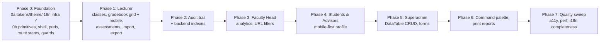
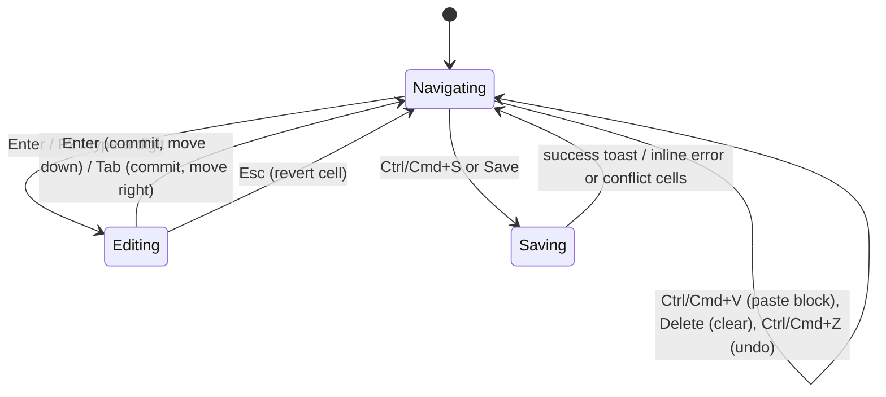

# OBE Gradebook: full UI/UX overhaul (phased) — revision 2

Branch: `feat/ux-overhaul`. App: `plo-canvas` (Next 16.4 / React 19.3 / Tailwind v4 / MongoDB 7 replica set).

## Final status (2026-11-03): all phases done

One commit per phase on `feat/ux-overhaul`. Every commit passed typecheck, lint, Vitest and `next build`, and was checked in the browser (desktop and phone widths, light and dark, English and Indonesian where relevant).

| Phase | Commit | Where it differs from the plan |
|---|---|---|
| 0 Foundation | `89959b7` | See "0b: done" below. Desktop top bar and drawer swipe were deferred, then done in Phases 1 and 7 (breadcrumbs sit above the page header instead of in a top bar) |
| 1 Lecturer | `bdd55a5` | Grade saves carry `expected` values; conflicts come back as 409 and are resolved per cell (change #5). Tabs became URL-driven and mount lazily |
| 2 Audit + backend | `80e681f` | History filters by change *kind* rather than single action. Pre-aggregation matched the seed DB to 1.4e-14 |
| 3 Heads | `b8bec9a` | Radar series also differ by dash and marker shape; drill-downs open under their row |
| 4 Students/advisors | `f16a824` | `?from=` is allow-listed and keeps the originating filters |
| 5 Superadmin | `9de92ce` | Deletes name dependents through one declaration that drives both the dialog and the server guard. Found and fixed: inline table cell definitions remounted every cell on each render |
| 6 Palette + reports | `0f0db5d` | Preferences had already moved to Phase 0. Reports live in a chrome-free `(print)` route group |
| 7 Quality | this commit | See below |

**Phase 7 results**
- Remaining hard-coded strings translated (status badges, Canvas parser warnings now codes, metadata). A test fails on any message key used in code but missing from the files.
- Focus not obscured: scroll padding accounts for the phone header, sticky tab bar and the docked Save bar.
- Phone drawer: swipe to close (follows the finger unless reduced motion is on).
- `npm run seed -- --large` (~600 students). Measured against a separate database:
  - At-Risk page 3.3 MB → 0.87 MB and Cohort Overview 1.2 MB → 0.41 MB (dev build, uncompressed), by paginating the students table and packing attainment sums for transport.
  - Gradebook with 153 students: cursor movement median 7 ms, worst 40 ms; typing ~20 ms (dev build) after memoising row previews; well under the 200 ms INP target.
- Bug found and fixed: a session whose account was deleted or deactivated caused a `/login` ↔ app redirect loop; it is now ended with a notice.
- Not done: a screen-reader (VoiceOver) pass by a person, and review of the Indonesian wording by a native speaker (Open question 2). Server-side error messages are still English only.

## Status (2026-11-01)

The previous run stopped partway through Phase 0. What exists on disk, uncommitted:

| Done | Where |
|---|---|
| Dependencies installed: `sonner`, `@tanstack/react-table`, `cmdk`, `next-intl`, `exceljs` | `package.json` |
| OKLCH tokens with `light-dark()`, `warn`/`info`/`solid-fg` tones, chart tokens, 3-step elevation, motion tokens, dialog/popover/drawer/skeleton CSS, print base | `src/app/globals.css` |
| Theme store (System/Light/Dark, `useSyncExternalStore`, cross-tab sync) and pre-paint script | `src/lib/theme.ts`, `src/app/layout.tsx` |
| `next-intl` without routing (cookie `NEXT_LOCALE`, default `en`), `en.json`/`id.json` with 129 matching keys in 10 namespaces | `src/i18n/*`, `messages/*`, `next.config.ts` |
| Sonner `Toaster` styled with tokens | `src/components/ui/toaster.tsx` |
| Primitives v1: `Button` (`loading`, icon sizes, press scale), `Input` (`invalid`), `NumberInput`, `Textarea`, `Field` (hint/error), `Table` (`label`, `maxHeight`), `Breadcrumbs`, `EmptyState` (title/reason/action), `SummaryStrip`, `Kbd`, `Spinner`, `Skeleton`, `Meter` | `src/components/ui/index.tsx` |

**What was broken, and fixed in this revision.** The new tokens switch the whole app to dark when the OS is dark, but several components still used light-only colours, so system-dark users got unreadable UI:
- White text on `bg-brand`/`bg-ok`, which become light fills in dark mode (sidebar logo, login logo, import stepper). Fixed with `text-brand-fg` and a new `--solid-fg` token.
- `Notice` used `red-50`/`sky-50` palettes. It now uses the `risk`/`info` tokens and gains a `warn` tone.
- The gradebook's dirty-cell style used `amber-50`. It now uses `warn` tokens.
- `PloRadar` used hard-coded hex values for the series, grid, axis, and target. It now uses `var(--chart-*)`.
- Tailwind's `dark:` variant followed only the OS, not the stored override. A `@custom-variant dark` now respects `data-theme`. The one `dark:` use (the danger button) was replaced by `text-solid-fg`.
- The dialog enter/exit CSS existed but nothing used it. `Dialog` now has the `ui-dialog` class, and its content stays mounted until the exit transition ends.

Verified: typecheck, lint, Vitest (20/20), and `next build` pass. In the browser (dark scheme, 1440px) the login, My Classes, class radar, gradebook, and the import dialog open/close were checked as `lecturer1`.

**Not done yet in Phase 0:** see the checklist under Phase 0.

---

## What changed from revision 1, and why

| # | Change | Reason |
|---|---|---|
| 1 | Phase 0 now has a **token guard test** and a **contrast test** | The breakage above came from raw palette classes left behind after the token switch. A test that fails on `text-white`, `bg-red-50`, or hex values in `src/components` and `src/app` stops it from happening again, and the contrast test turns "≥4.5:1 in both themes" into something checked automatically rather than by eye |
| 2 | **Preferences dialog moved from Phase 6 to Phase 0** | Revision 1 shipped dark mode in Phase 0 but no way to choose a theme or language until Phase 6. `User.locale` also moves to Phase 0, so sign-in can set the `NEXT_LOCALE` cookie from it |
| 3 | **Tabs and client-only filters use `history.replaceState`, not `router.replace` / `<Link>`** | Every page here is dynamic. `router.replace` or a `<Link>` to `?tab=x` refetches the whole server component tree on each tab click or slider move. Next's App Router keeps `useSearchParams` in sync with the native History API (since 14.1), so URL state stays shareable without a server round trip. `router.replace` is kept only for params the server reads |
| 4 | **The unsaved-changes guard is described honestly** | Browsers can't cancel a back/forward navigation reliably. The guard covers reload and close (`beforeunload`), in-app links (`<Link onNavigate>` plus a capture-phase click handler for plain `<a>`), and the app's own `router.push` calls. For back/forward it is best effort: it keeps the dirty state and shows a "You have unsaved changes" banner if the user comes back |
| 5 | **The grade save API sends dirty cells only, each with the value the client last saw** | This one payload change gives Phase 2 its audit diff for free *and* adds optimistic concurrency. If two people edit the same class, conflicting cells come back as `409 {conflicts}` and are highlighted in the grid instead of being silently overwritten |
| 6 | **Audit events are always written in the same transaction** | `docker-compose.yml` already runs Mongo as the replica set `rs0` (the Canvas import already uses transactions), so "when a replica set is available" is dropped. `recomputeOffering` stays outside the transaction because it rebuilds derived data and is idempotent |
| 7 | **Pre-aggregation is "equal within 1e-9", not bit-exact** | Σ(value·sks)/Σsks decomposes exactly in maths, but floating-point addition order changes. The `$match` must also copy the engine's filters (`sks > 0`, finite value) ([engine.ts:142](../src/lib/obe/engine.ts)). The equivalence test uses `toBeCloseTo` |
| 8 | **The redundant `attainment {student:1}` index is dropped** | The new compound index `{student, studentSemester, ploNumber}` already serves it. Fewer indexes means cheaper writes during recompute |
| 9 | ~~Page transitions use Next's `experimental.viewTransition` + React `<ViewTransition>`~~ **Superseded in 0b:** no flag is needed, and a page-wide wrapper animates every URL-state change. View transitions are scoped to named elements instead | |
| 10 | **`theme-color` follows a manual override** | `setThemeMode` also updates `<meta name="theme-color">`. Right now the browser chrome follows the OS even when the user picked a theme |
| 11 | **Phase 0 is split into 0a (done) and 0b**, still one commit for the phase | This keeps the "one commit per phase" decision, but gives a review checkpoint (see Open questions) |
| 12 | **The `exceljs` risk is flagged** | Its last release (4.4.0) was in 2023, and it is about 1 MB. It is lazy-loaded, so it's acceptable. If you'd rather, `write-excel-file` covers write-only export at a fraction of the size. Kept as `exceljs` unless you say otherwise |
| 13 | **The Docker caution is removed** | Docker is running. The Mongo container is healthy |

---

## Goal and decisions (unchanged from the interview)

| # | Decision |
|---|---|
| Scope | Everything, delivered in phases: UX polish, a refined visual language, and new features |
| Phase order | Shared foundation first, then **Lecturers**, then Heads, Students, Admin |
| Dependencies | Keep the in-house components. Add only `sonner`, `@tanstack/react-table`, `cmdk`, `next-intl`, and `exceljs` (lazy-loaded). Radix only if a menu really needs it |
| Gradebook (desktop) | Spreadsheet grid with an explicit Save. Arrow/Enter/Tab navigation, paste from Excel or Sheets, sticky header and first column, live course-grade preview, a guard against leaving with unsaved changes, and ⌘/Ctrl+S |
| Gradebook (phone) | Grade one assessment at a time with large inputs (the keyboard's Next key moves to the next student), plus a per-student view. A Save bar docked at the bottom |
| Visuals | Evolve the current navy and Geist look. Semantic tokens. Light, dark, and system themes. Theme-aware charts. **Must not look like AI slop.** Purposeful motion and fine details, based on credible sources |
| Language | **English by default, Bahasa Indonesia as an option.** `next-intl`, choice stored in a cookie and on the user profile. No locale in URLs |
| Mobile | **Full parity**, gradebook editing included |
| New features | CSV/XLSX export, print/PDF accreditation reports, ⌘K command palette and global search, grade audit trail |
| Audit trail | Grade, assessment, and threshold changes (old → new, who, when). A per-class History tab and a history popover on each grid cell. Read-only for Heads and Admin. No revert |
| Quality | WCAG 2.2 AA, perceived performance (streaming, skeletons, lazy loading), backend query and index review |
| Delivery | One commit per phase on `feat/ux-overhaul`. Each phase must pass typecheck, lint, Vitest, and `next build`. New unit tests. Browser checks at desktop and mobile widths, in light and dark |



---

## Current app: research summary

**Strengths to keep:** small, consistent primitives in [ui/index.tsx](../src/components/ui/index.tsx); a native `<dialog>`; a colour-blind-safe radar palette whose values are also offered as an accessible table; a solid four-step Canvas import wizard; transactions already used for import. About 6k lines of code, so a full overhaul is realistic.

**Gaps:**

| Area | Finding |
|---|---|
| Route states | No `loading.tsx`, `error.tsx`, or `not-found.tsx` anywhere. Navigation shows a blank wait, and errors show the default Next.js page |
| Feedback | Every message is an inline `Notice`. Destructive actions use native `confirm()` (`OfferingWorkspace.tsx`, `ResourceSection.tsx`). Settings save has no pending state |
| Gradebook | Inputs are `type="number"` (the scroll wheel changes values, and `85,5` can't be typed). No keyboard grid, paste, or leave guard. The header doesn't stick. The course grade updates only after saving. Saves are last-write-wins |
| Tables | No sorting, pagination, or sticky header. Search exists only on Users. The At-Risk page shows **two** competing period selectors (`AtRiskDashboard.tsx` and `StudentAttainmentTable.tsx`) |
| State | Filters, period, and threshold "what-if" live only in component state, so they're lost on reload and can't be shared as a link |
| Navigation | Back links are hard-coded per role. The student profile's back link is chosen by role, not by where you came from |
| Mobile | The drawer has no Esc handling, no focus return, and no animation. Wide matrices only scroll sideways |
| Backend | `Assessment` has no index for `find({offering})` (its only index is partial, on `canvasId`). `User` has no `{roles, department}` index. `getStudentsWithRows` sends every attainment row for the department to the browser (`queries.ts:384`) |

---

## Design direction

The aim is a calm, precise tool where the data is the hero. Every rule below cites a source.

### What we deliberately avoid (anti-"AI slop")

Purple or blue gradients, rows of identical icon cards, glassmorphism, gradient text, emoji in headings, and the same large radius with a soft shadow on everything ([Anthropic, frontend-design skill](https://github.com/anthropics/skills/blob/main/skills/frontend-design/SKILL.md)). In this app that means:
- **One accent (navy), with neutrals tinted toward it.** Hierarchy comes from weight and colour, not just size ([Refactoring UI](https://www.refactoringui.com/)).
- **Concentric nested radii** (inner = outer − padding). Layered, tinted shadows from one light source on a 3-step elevation scale ([Vercel Web Interface Guidelines](https://vercel.com/design/guidelines)).
- **No walls of KPI cards.** `SummaryStrip` replaces the four-card rows: one surface with dividers, and each number carries a trend or target hint.
- **Geist stays.** `tabular-nums` on every number.

### Motion tokens (implemented in `globals.css`)

| Token | Value | Use | Source |
|---|---|---|---|
| `--dur-1` | 100ms | Press and toggle feedback, focus | [NN/g](https://www.nngroup.com/articles/animation-duration/) |
| `--dur-2` | 160ms | Hover, menu or popover in | [Vercel](https://vercel.com/design/guidelines) |
| `--dur-3` | 240ms | Dialog or sheet in, row insert | [M3](https://m3.material.io/styles/motion/easing-and-duration/tokens-specs) |
| exits | ~70% of enter | Dialog or toast out | M3 |
| `--ease-out` | `cubic-bezier(0.23,1,0.32,1)` | Anything entering | [Emil Kowalski](https://emilkowal.ski/ui/great-animations) |
| `--ease-std` | `cubic-bezier(0.2,0,0,1)` | Moves and resizes | M3 |

**Not animated:** moving between grid cells, the ⌘K palette, keyboard shortcuts, theme switching, or anything done 100+ times a day ([Emil Kowalski](https://emilkowal.ski/ui/you-dont-need-animations)).
**Animated:** dialog and sheet enter/exit, toasts, the at-risk drill-down expansion, the radar morphing between periods, the dirty-cell marker, and number tick-ups in the summary strip. Page navigation uses View Transitions as progressive enhancement.
**Reduced motion** is handled per element: movement becomes a ≤100ms fade, with no global kill switch ([web.dev](https://web.dev/articles/prefers-reduced-motion)).

### Small-details checklist (applies to every phase)

- Saving buttons keep their label and add a spinner and `aria-busy`. Loaders appear after 150–300ms and stay at least 300–500ms ([Vercel](https://vercel.com/design/guidelines)).
- Under 1s, show nothing. From 1 to 10s, show a skeleton for a view or a spinner for a local action. Past 10s, show a progress bar ([NN/g](https://www.nngroup.com/articles/response-times-3-important-limits/)).
- Toasts are for passive confirmations only. Errors that need fixing go inline at their source. Banners are for page-level state ([NN/g](https://www.nngroup.com/articles/indicators-validations-notifications/)).
- Confirmation dialogs only for serious, irreversible actions, with the safe action autofocused ([NN/g](https://www.nngroup.com/articles/confirmation-dialog/)).
- Error messages say what happened and how to fix it. A failed submit shows a focused error summary that links to each field ([GOV.UK](https://design-system.service.gov.uk/components/error-summary/)). Validation waits until the user leaves a field (`:user-invalid`, with `aria-invalid` kept in sync).
- Empty states say *why* it's empty and offer one next action ([NN/g](https://www.nngroup.com/articles/empty-state-interface-design/)).
- Pass/fail is never shown by colour alone ([WCAG 1.4.1](https://www.w3.org/WAI/WCAG22/Understanding/use-of-color.html)).
- Targets are at least 24×24px, and 44px on touch ([WCAG 2.5.8](https://www.w3.org/WAI/WCAG22/Understanding/target-size-minimum.html)). Sticky bars never cover focus, handled with `scroll-padding` ([WCAG 2.4.11](https://www.w3.org/WAI/WCAG22/Understanding/focus-not-obscured-minimum.html)).
- Filters, sort, tab, and period live in the URL (via `history.replaceState`, see change #3). Scroll position is restored on back.
- Numbers use `Intl.NumberFormat` with the locale from `INTL_LOCALE`. Grade entry accepts `85.5` and `85,5`.
- Mobile inputs: `type="text" inputmode="decimal" enterkeyhint="next"`, ≥16px font, and bottom bars padded with `env(safe-area-inset-bottom)`.
- Dark mode: no pure black, higher surfaces are lighter, accents are desaturated, and chart colours are re-tuned (Okabe-Ito based). Text ≥4.5:1, and UI and chart strokes ≥3:1, **checked by `tests/tokens-contrast.test.ts`**.
- **Colours only through tokens.** No raw Tailwind palette classes (`red-50`, `text-white`) or hex in components, **checked by `tests/no-raw-colors.test.ts`**.

---

## Phase 0: Foundation

### 0a: done (see Status)

### 0b: done (2026-11-01), uncommitted

Everything in the checklist below is built, with these differences from the plan:

| Item | What happened |
|---|---|
| Contrast test | It caught three failing tokens, now fixed: `--subtle` (hints and placeholders, was 3.3–4.2:1), `--chart-tick` (4.3:1), and input borders (1.6:1). A new `--border-input` token gives ≥3:1 for form-control edges (WCAG 1.4.11). Form fields are also 44px tall on touch screens |
| View transitions | **No page-wide `<ViewTransition>`.** Next applies every query-string sync (sort, filter, tab) as a React transition, and React animates any transition inside a `<ViewTransition>`, so a page-level wrapper cross-faded the whole page on every sort click. No config flag is needed in Next 16.4 (change #9 was wrong about that). Later phases add scoped, named transitions (radar morph, drill-down) filtered by transition type |
| `useUrlState` | Local state is the source of truth and the URL follows. Reading straight from `useSearchParams` lags behind input, because Next applies URL changes in a transition. Calls `history.replaceState(null, …)`: passing `history.state` carries Next's internal marker, and Next then skips the `useSearchParams` sync |
| Desktop top bar | **Deferred to Phase 1.** Until pages supply breadcrumbs and actions, it would be empty chrome. `--app-sticky-top` is already in place for sticky tab bars |
| Drawer | Native modal `<dialog>`: Esc, backdrop click, focus return, closes on navigation, and animation. **Swipe-to-close is not done** (deferred to Phase 7) |
| DataTable | In the stacked phone layout the header row is hidden, so there's no sort control. Add a "Sort by" select when a phone screen first needs sorting (Phase 1 class list) |
| Strings | Shell, nav, login, route states, Preferences, and primitive labels use `next-intl`. Page bodies move when each page is reworked |
| Verification | Checked in the browser at 1440/1280/390px, light and dark, EN and ID. The built-in browser pane was hidden for part of the run, which stops `requestAnimationFrame`: streamed pages then stay on their skeleton because React's reveal waits for a frame. Recheck one full page load in a visible browser |

<details><summary>Original 0b checklist</summary>

**Guards first** (so the rest of Phase 0 can't regress):
- [ ] `tests/no-raw-colors.test.ts`: globs `src/**/*.tsx`, and fails on `\b(bg|text|border|ring|fill|stroke)-(white|black|gray|slate|zinc|red|green|amber|sky|…)-?\d*` and on `#[0-9a-f]{3,6}` outside `globals.css`. An allow-list covers backdrops (`bg-black/40`).
- [ ] `tests/tokens-contrast.test.ts`: parses each `light-dark()` pair from `globals.css`, converts OKLCH → sRGB with a ~30-line helper (no new dependency), and asserts foreground/muted/brand/ok/risk/warn/info on background/surface/surface-2 ≥4.5:1 and chart/border-strong ≥3:1 in both schemes.

**Primitives** ([ui/index.tsx](../src/components/ui/index.tsx), [ui/client.tsx](../src/components/ui/client.tsx)):
- [ ] `Dialog`: `dirty` prop (Esc or backdrop → "Discard changes?" step), `closedby`, an initial-focus target, and a `sheet` variant (bottom sheet below 40rem; the CSS already exists).
- [ ] `ConfirmDialog` plus a `useConfirm()` hook returning `Promise<boolean>` (a drop-in for `confirm()`), destructive tone, safe action autofocused.
- [ ] `Tooltip`: `popover="hint"` where supported, otherwise `popover="manual"`, positioned with CSS anchor positioning and a small JS fallback; delay on first hover only.
- [ ] `SegmentedControl` (radio group semantics).
- [ ] `Tabs`: keep client-side switching; add roving tabindex with arrow/Home/End, `aria-controls`, a sliding underline, and a `sticky` option. URL sync uses `history.replaceState` (already the case).
- [ ] `Menu` (for user and overflow menus): `popover` + a button with `aria-expanded`, arrow-key navigation. Bring in Radix only if this proves insufficient.
- [ ] `Notice` gets an optional `action` (the `warn` tone is done).

**Data table** (`src/components/ui/data-table.tsx`): TanStack-based. Sortable headers with `aria-sort`, global search, optional pagination, comfortable/compact density, sticky header and first column, a focusable `role="region"` wrapper, and an export slot. Below `@container (width < 40rem)` it switches to stacked cards. Numeric columns are right-aligned, header included. Sort, search, and page sync to the URL through `useUrlState`.

**Hooks** (`src/lib/hooks/`):
- [ ] `useUrlState(key, parse, serialize)`: reads `useSearchParams`, writes with `history.replaceState` (client-only state). An option `{ server: true }` uses `router.replace(..., { scroll: false })` for params the server reads.
- [ ] `useUnsavedChangesGuard(dirty)`: `beforeunload`, a capture-phase click on same-origin `<a>`, and a `confirmNavigation()` helper for the app's own `router.push` calls. Back/forward is best effort (change #4).
- [ ] `useHotkeys`: ⌘ on macOS, Ctrl elsewhere; ignored inside text inputs unless opted in.

**Shell** ([AppShell.tsx](../src/components/AppShell.tsx)):
- [ ] Mobile drawer becomes a modal `<dialog class="ui-drawer">`. This gives Esc, focus return, light dismiss (`closedby="any"` with a click-outside fallback), and animation; the CSS exists.
- [ ] User menu at the bottom of the sidebar: name, role, **Preferences…**, Sign out, and a ⌘K hint (shown in Phase 6).
- [ ] Active-nav indicator, a sticky desktop top bar (breadcrumbs, page actions), and safe-area padding on the mobile header.

**Preferences** (moved from Phase 6):
- [ ] `PreferencesDialog`: Theme (System, showing "currently Dark" / Light / Dark) and Language (English / Bahasa Indonesia).
- [ ] `PATCH /api/me {locale}` sets the cookie and `User.locale`. The client calls `router.refresh()` so server components re-render in the new language.
- [ ] `User.locale` field (`enum ["en","id"]`, default `"en"`). `POST /api/auth/login` sets `NEXT_LOCALE` from it.
- [ ] `setThemeMode` also updates `<meta name="theme-color">`.

**Route states** (`src/app/(app)/`):
- [ ] `loading.tsx` per route group with skeletons matching the real layout (class list, workspace, analytics), so nothing shifts.
- [ ] `error.tsx`: a plain-language message, "Try again" (`reset()`), and "Go to my home". `global-error.tsx` for the root.
- [ ] `not-found.tsx`: "This class doesn't exist or you don't have access." Pages call `notFound()` instead of rendering an inline message.

**Login** ([login/page.tsx](../src/app/login/page.tsx), [login-form.tsx](../src/app/login/login-form.tsx)):
- [ ] Language switcher, show/hide password, caps-lock hint, correct `autocomplete` tokens, a loading button, and an error tied to its field.
- [ ] Two panes on desktop (a quiet left panel explaining the app, no gradients); single column on mobile.

**View transitions:** `experimental.viewTransition: true` in `next.config.ts`, with a `<ViewTransition>` around `<main>` for a short cross-fade (the CSS exists).

**Strings:** move the Phase 0 surfaces (shell, login, route states, primitives' built-in labels such as "Close") onto the existing `common`/`nav`/`shell`/`prefs`/`confirm`/`errors`/`login`/`table` namespaces.

</details>

---

## Phase 1: Lecturer experience

### Classes list ([lecturer/page.tsx](../src/app/(app)/lecturer/page.tsx))
- Grouped by period, with the current term first and expanded and past terms collapsed.
- Desktop shows a `DataTable` (search, period filter, sort). Mobile shows class cards with a mini PLO strip and a status badge.
- A **"Needs attention"** row: classes with no assessments, PLOs mapped but never measured, or students below target, each linking to the right tab.

### Offering workspace
- **First, a pure refactor:** split the 566-line [OfferingWorkspace.tsx](../src/components/offering/OfferingWorkspace.tsx) into `offering/tabs/{Radar,Gradebook,Assessments,Settings}Tab.tsx` (History arrives in Phase 2). Run the checks, then build features on top.
- Header: breadcrumbs (*My Classes › COMP4334*), the primary action (Import Canvas CSV), an overflow `Menu` (Export, Print class report in Phase 6), and a sticky tab bar.

### Gradebook state and save API (shared by desktop and mobile)
- `src/lib/gradebook/{parse-score,paste,state}.ts`, pure and unit-tested:
  ```ts
  /** "85,5" | "85.5" | " 90 " → number; "" → null; garbage → NaN. */
  export function parseScore(raw: string): number | null;
  /** TSV block → rectangular matrix; handles \r\n and a trailing newline. */
  export function parseClipboardMatrix(text: string): string[][];
  /** Applies a pasted matrix at (row, col), clipped to the grid; returns changed keys for one undo step. */
  export function applyPaste(values, origin, matrix, students, assessments): { next; changed: string[] };
  ```
- `useGradebookState`: values, the baseline (last saved), dirty set, invalid set, undo stack, and live `courseGrade`/`letterGrade` per row from [engine.ts](../src/lib/obe/engine.ts).
- **Save payload (change #5):** `PUT /grades { grades: [{ student, assessment, score, expected }] }` with dirty cells only. `expected` is the baseline value. The server compares it with the stored value: any mismatch → `409 { conflicts: [{student, assessment, current}] }`, nothing written. The grid marks those cells and offers "Use theirs / Keep mine" per cell. The validator gets `expected: number | null`, made optional for one release so the old client keeps working.

### Desktop grid (`offering/gradebook/GradeGrid.tsx`)
WAI-ARIA **Grid** pattern ([APG](https://www.w3.org/WAI/ARIA/apg/patterns/grid/)):



- One tab stop, roving tabindex, a 2px brand ring for the cell cursor, no animation between cells.
- Paste validates every cell. Invalid cells get a mark and a tooltip. One undo step per paste.
- Dirty cells get a `warn` left marker plus a dot (not colour alone). A sticky footer reads *"7 unsaved changes · 1 invalid"* with Discard and **Save (⌘S)**. `aria-live="polite"` announces the save result.
- The row's course grade and letter update as you type, shown in italics until saved.
- Headers show max points, weight, and PLO chips, and stay visible on vertical scroll; the first column stays visible on horizontal scroll.
- Toolbar: student search, "Show only missing", Export, density.
- After saving: toast *"Saved 7 grades · PLO attainment recalculated"* and `router.refresh()` for the radar data.
- Performance budget: typing in a 40×10 grid stays ≤200ms INP on the large seed. Cells are memoised by key, so a keystroke re-renders one cell plus its row's preview.

### Phone grader (`offering/gradebook/MobileGrader.tsx`, below `md`)
- `SegmentedControl`: **By assessment** / **By student**.
- By assessment: an assessment picker (a sheet), then the student list with large `NumberInput`s (`enterkeyhint="next"`), a "/ max" suffix, and a live letter badge.
- By student: prev/next (with swipe) through students, all assessments stacked.
- The Save bar is docked at the bottom with safe-area padding. `scroll-padding-bottom` keeps the focused input clear of it.
- Uses the same `useGradebookState` and guard as desktop.

### Assessments tab and [PloWeightEditor.tsx](../src/components/offering/PloWeightEditor.tsx)
- `useConfirm()` replaces `confirm()` and states how many grades will be deleted.
- Grade-weight total as a meter against 100%, with a warning when it doesn't add up.
- The unmeasured-PLO warning gets an action: *"Add an assessment for PLO 9"*.
- The effective-weight matrix becomes a heatmap with numbers in every cell.
- Weight editor: slider plus number input, and a "Split evenly" preset.
- The Assessment dialog is `dirty`-aware and validates inline.

### Canvas import ([CanvasImportWizard.tsx](../src/components/offering/CanvasImportWizard.tsx))
- Drag-and-drop zone with a click alternative (WCAG 2.5.7). Stepper as `<ol>` with `aria-current="step"`. A "needs attention" filter on mapping rows. A before → after dry-run summary. Determinate progress while writing. A "View gradebook" CTA at the end. Wizard notices and confirms move onto the new primitives.

### Export (`src/lib/export/{csv,xlsx}.ts`)
- `toCsv(rows, columns)`: RFC 4180 quoting, UTF-8 BOM, and a leading `'` on cells starting with `= + - @` (prevents CSV formula injection when a student name starts with one of those).
- `downloadXlsx()`: `await import("exceljs")` on click only. Frozen header, number formats.
- First used by the gradebook (raw, %, letter, PLO attainment sheets) and the class attainment table.

### Settings tab
The threshold becomes `NumberInput` plus a slider, with a preview: *"At 75%, 4 more students would be flagged"*. Loading button and success toast.

---

## Phase 2: Audit trail and backend performance

### Models ([models/index.ts](../src/models/index.ts))
```ts
const auditEventSchema = new Schema({
  offering: { type: ObjectId, ref: "CourseOffering", required: true },
  actor:    { type: ObjectId, ref: "User", required: true },
  actorName: String,                                   // denormalised for fast lists
  action: { type: String, enum: ["grade.set","grade.clear","assessment.create","assessment.update",
                                  "assessment.delete","threshold.update","canvas.import"], required: true },
  source: { type: String, enum: ["manual","canvas"], default: "manual" },
  batch: { type: String, required: true },             // one save / one import
  student: { type: ObjectId, ref: "User" },
  assessment: { type: ObjectId, ref: "Assessment" },
  assessmentTitle: String,                             // survives assessment deletion
  before: Schema.Types.Mixed, after: Schema.Types.Mixed,
}, { timestamps: { createdAt: true, updatedAt: false } });
auditEventSchema.index({ offering: 1, createdAt: -1, _id: -1 });                   // timeline + cursor
auditEventSchema.index({ offering: 1, student: 1, assessment: 1, createdAt: -1 }); // cell popover

assessmentSchema.index({ offering: 1, createdAt: 1 });
userSchema.index({ roles: 1, department: 1, cohortYear: 1, name: 1 });
attainmentSchema.index({ student: 1, studentSemester: 1, ploNumber: 1 });
// drop attainmentSchema.index({ student: 1 }): covered by the compound index above (change #8)
```
(`User.locale` already landed in Phase 0.)

### Recording (`src/lib/audit/{diff,record}.ts`)
- `diffGrades(existing, incoming)`: pure and tested. It produces `grade.set`/`grade.clear` events and skips no-op writes.
- `recordAudit(events, session)`: always inside the same `withTransaction` as the change (change #6). The grades route becomes: start session → read current values (also used for the 409 conflict check) → `bulkWrite` → `AuditEvent.insertMany` → commit → `recomputeOffering` outside the transaction.
- Wired into the grades route, the assessment create/update/delete routes, the offering threshold update in `offerings/[id]/route.ts`, and `lib/canvas/import.ts` (one `canvas.import` summary plus per-cell `grade.set` events sharing one `batch`).
- Deleting an assessment records the grade count and keeps its title on the events.

### History API and UI
- `GET /api/offerings/[id]/history?cursor=&student=&assessment=&action=`. The cursor is `(createdAt, _id)`. Access is checked with `canAccessOffering(user, id, "read")`.
- `offering/tabs/HistoryTab.tsx`: a timeline grouped by batch (*"Andi Wijaya saved 7 grades · 14:02"*), expandable to show old → new values.
- Grid cell context menu and ⌥/Alt+H open a history popover for that cell.

### Queries ([queries.ts](../src/lib/obe/queries.ts), [aggregate.ts](../src/lib/obe/aggregate.ts))
- `getStudentsWithRows` stops shipping raw rows. A `$match` (same filters as the engine: `sks > 0`, finite value) followed by `$group` on `{student, studentSemester, ploNumber}` returns `{sum: Σvalue·sks, sks: Σsks}`. Client-side `cumulativeForStudent` sums the semesters inside the chosen period. Results equal the current implementation within 1e-9 (change #7).
- `getOfferingDetail`/`listOfferings`: independent queries run in parallel with `Promise.all`, and projections are trimmed with `.select()`.
- Verify each new index with `explain("executionStats")` on the large seed (`IXSCAN`, `totalDocsExamined ≈ nReturned`) and record the before/after numbers in the walkthrough.

---

## Phase 3: Faculty Head analytics

([CohortDashboard.tsx](../src/components/head/CohortDashboard.tsx), [AtRiskDashboard.tsx](../src/components/head/AtRiskDashboard.tsx), [CourseMatrix.tsx](../src/components/head/CourseMatrix.tsx), `head/*` pages)
- **One filter bar per page**, synced to the URL (`?period=y2&threshold=75&cohorts=2023,2024`) through `useUrlState`. The duplicate period selector in `StudentAttainmentTable` is hidden when a parent controls the period.
- The threshold what-if is clearly labelled (*"Exploring at 75%; saved target is 70%"*, with a Reset chip).
- Cohort selection uses toggle chips in their series colours. The 3-series cap is explained in a tooltip.
- The at-risk drill-down expands under its matrix row (animated), with row actions: Open profile, Copy emails, Export list.
- The course matrix becomes a heatmap with numbers, a sticky course column, and a legend.
- Mobile: matrices switch to a "pick one PLO" view ([NN/g mobile tables](https://www.nngroup.com/articles/mobile-tables/)).
- CSV/XLSX export on every table.

[PloRadar.tsx](../src/components/charts/PloRadar.tsx) (theme colours are already done):
- Series are told apart by marker shape and dash pattern as well as colour.
- Values morph between periods (`--dur-3`, off under reduced motion).
- A clickable legend focuses a series. Axis labels get a tooltip with the PLO description.
- Lazy-loaded with `next/dynamic` and a skeleton.

---

## Phase 4: Students and advisors

([student/page.tsx](../src/app/(app)/student/page.tsx), [StudentProfile.tsx](../src/components/StudentProfile.tsx), [students/[id]/page.tsx](../src/app/(app)/students/[id]/page.tsx), [advisees/page.tsx](../src/app/(app)/lecturer/advisees/page.tsx))
- Phone-first layout: summary strip → radar → outcome list (each PLO a `Meter` against target) → course cards that expand (`interpolate-size`, with a fallback) to show assessments.
- Period as a `SegmentedControl` (All · Y1 · Y2 · Y3 · Y4, semesters in an overflow menu), synced to the URL.
- Plain-language guidance: *"PLO 6 is below target. It's assessed in COMP2424 and COMP3311."* (from the course→PLO mapping).
- Breadcrumbs follow where the user came from (`?from=`, validated against an allow-list of internal paths, with the role default as fallback).
- Advisees: a `DataTable` sortable by number of at-risk PLOs, with an at-risk-only filter.

---

## Phase 5: Superadmin

([ResourceSection.tsx](../src/components/admin/ResourceSection.tsx), [AdminViews.tsx](../src/components/admin/AdminViews.tsx))
- All lists on `DataTable` with search, sort, pagination, and export.
- Forms in a `Dialog` (a sheet on mobile), validating after interaction, with an error summary, `dirty`-aware.
- `useConfirm()` names the item and its dependents (*"Deleting COMP1401 removes 3 offerings"*). The count comes from a `GET ...?dependents=1` call made when the dialog opens.
- Multi-selects (roles, PLOs) become checkbox-chip groups.
- Users: bulk advisor assignment (multi-select rows, then "Assign advisor…").
- Overview: a summary strip plus a setup checklist (students without an advisor, courses without a PLO mapping) linking to each fix.

---

## Phase 6: Command palette and print reports

### Command palette (`src/components/CommandPalette.tsx`, `src/app/api/search/route.ts`)
- ⌘/Ctrl+K opens `cmdk` in a native dialog, lazy-loaded on first press.
- Role-aware navigation, recent items (localStorage, per user id), and debounced server search over students (name, NIM, email), classes, and courses.
- **RBAC-scoped:** the route builds its Mongo filter from the same predicates as `canViewStudent` and offering access, so out-of-scope documents are never fetched. A pure `scopeFilter(user)` function is unit-tested. Regex input is escaped and length-capped.
- Actions: Switch theme, Switch language, Preferences, Sign out.

### Print reports (`src/app/(app)/reports/{student/[id],offering/[id],cohort}/page.tsx`, `print.css`)
- A4 pages: university header, generated-at and generated-by, a fixed-size radar, `break-inside: avoid`, and repeated table headers.
- A "Print / Save as PDF" button calls `window.print()`.
- Student PLO transcript, class report, and cohort report, all bilingual. RBAC identical to the matching screens.

---

## Phase 7: Quality sweep

- **Accessibility (WCAG 2.2 AA):** keyboard-only pass of every flow; VoiceOver pass of the grid, dialogs, and palette; target sizes; focus visibility and focus not obscured; `aria-live` on save status and toasts. Token contrast is already covered by the Phase 0 test.
- **Performance:** `Suspense` boundaries so shells stream first; `next/dynamic` for Recharts, the import wizard, `exceljs`, and `cmdk`; prefetch on class and student links; `content-visibility: auto` on long lists; INP ≤200ms in the 40×10 grid on the large seed.
- **i18n completeness:** `tests/i18n-keys.test.ts` (same keys, no empty values, ICU placeholders match between `en` and `id`), plus a sweep for hard-coded strings.
- **README:** features, keyboard shortcuts, language and theme, seed flags.

---

## Verification plan

### Automated (every phase)
```bash
npm run typecheck && npm run lint && npm test && npm run build
```

| Test file | Phase | Covers |
|---|---|---|
| `tests/no-raw-colors.test.ts` | 0 | No raw palette classes or hex in components |
| `tests/tokens-contrast.test.ts` | 0 | Contrast of every text/UI token pair in light and dark |
| `tests/i18n-keys.test.ts` | 0 (extended in 7) | Same key set, no empty values, matching ICU placeholders |
| `tests/parse-score.test.ts` | 1 | `85,5`/`85.5`/blank/garbage, the 150% cap shared with the server |
| `tests/gradebook-paste.test.ts` | 1 | TSV, `\r\n`, trailing newline, clipping, undo key set |
| `tests/gradebook-state.test.ts` | 1 | Dirty/invalid tracking, undo, save payload with `expected`, conflict merge |
| `tests/export.test.ts` | 1 | CSV quoting, BOM, Indonesian characters, formula-injection escaping |
| `tests/audit-diff.test.ts` | 2 | set/clear/no-op detection, batch grouping |
| `tests/aggregate-equivalence.test.ts` | 2 | Pre-aggregated sums match row-based `cumulativeForStudent` within 1e-9 for every period filter |
| `tests/search-scope.test.ts` | 6 | `scopeFilter(user)` per role |

### Browser (every phase)
1. `docker compose up -d --wait && npm run seed && npm run dev` (the `.claude/launch.json` "dev" config is set up).
2. At **1440px, 768px, and 390px**, in **light and dark**, and in **EN and ID**, sign in as each seeded role (`Password123!`) and walk through that phase's flows. Phase 1 example as `lecturer1@…`: open COMP3311, paste a 3×4 block, check the live letter preview, try to leave (the guard appears), press ⌘S (a toast appears), then grade at 390px with the Next key. Then open the same class in two tabs, edit one cell in both, save both, and check that the second save shows the conflict.
3. Repeat with reduced motion emulated and with keyboard only.
4. Screenshots go into `docs/walkthrough.md`.

### What you should check
- The look and feel after Phase 0b and Phase 1: the main "doesn't look like AI slop" checkpoint.
- The Bahasa Indonesia wording.
- Print output on your actual printer or PDF settings (A4).

---

## Open questions

1. **Official brand assets.** Should I use the Sampoerna University logo and exact brand colours? If yes, put them in `public/brand/`. Otherwise the current navy stays as the OKLCH brand scale with the generic mark.
2. **Bahasa Indonesia review.** I'll write `id.json` keeping official terms (*SKS, NIM, Dosen Wali, CPL, UTS/UAS*). Should a native speaker at the university review it before release?
3. **Large demo seed.** May I add `npm run seed -- --large` (about 600 students, 40 offerings) for the performance and index work? The default seed stays unchanged.
4. **Theme control placement.** The plan puts System/Light/Dark in Preferences (user menu), next to language, and on the login page for language only. Say if you'd rather have a visible sun/moon toggle in the header.
5. **Checkpoint commit.** Phase 0a plus the dark-mode fixes is stable now. Commit it as a checkpoint (`feat(ui): design tokens, theme, i18n infrastructure`), or keep everything in one Phase 0 commit as originally decided?
